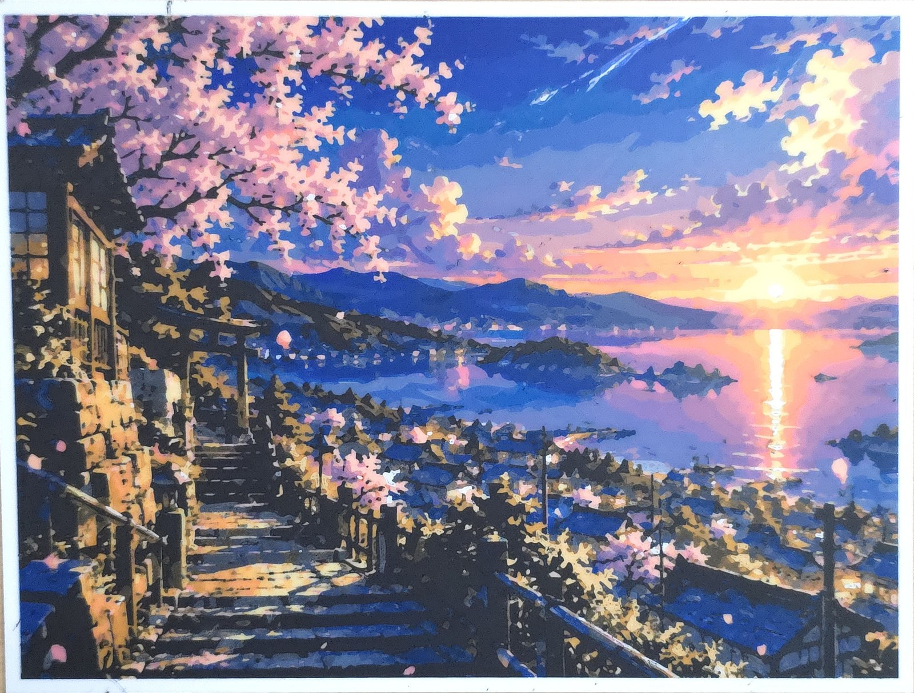
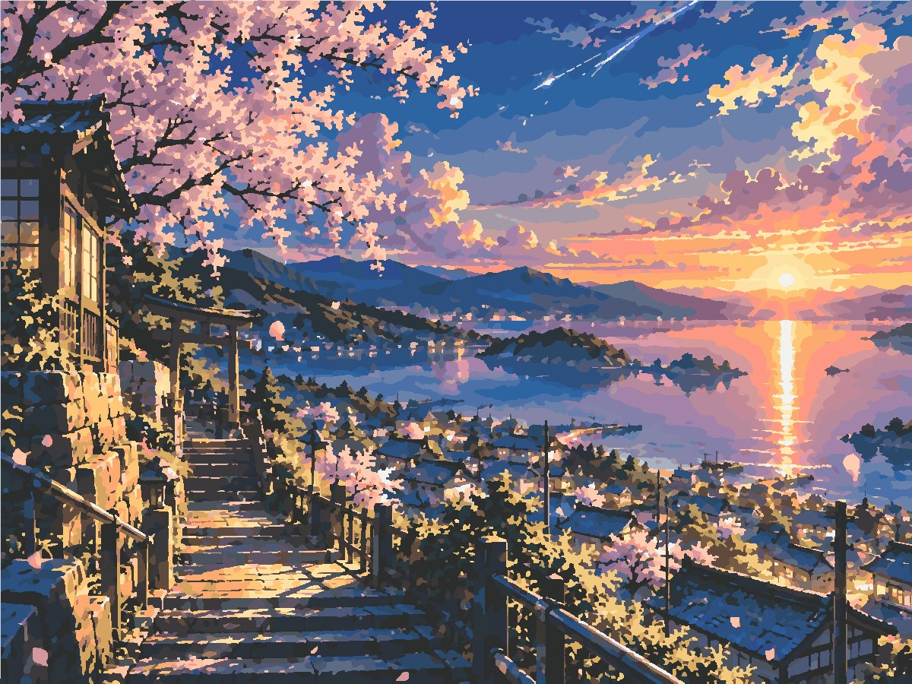
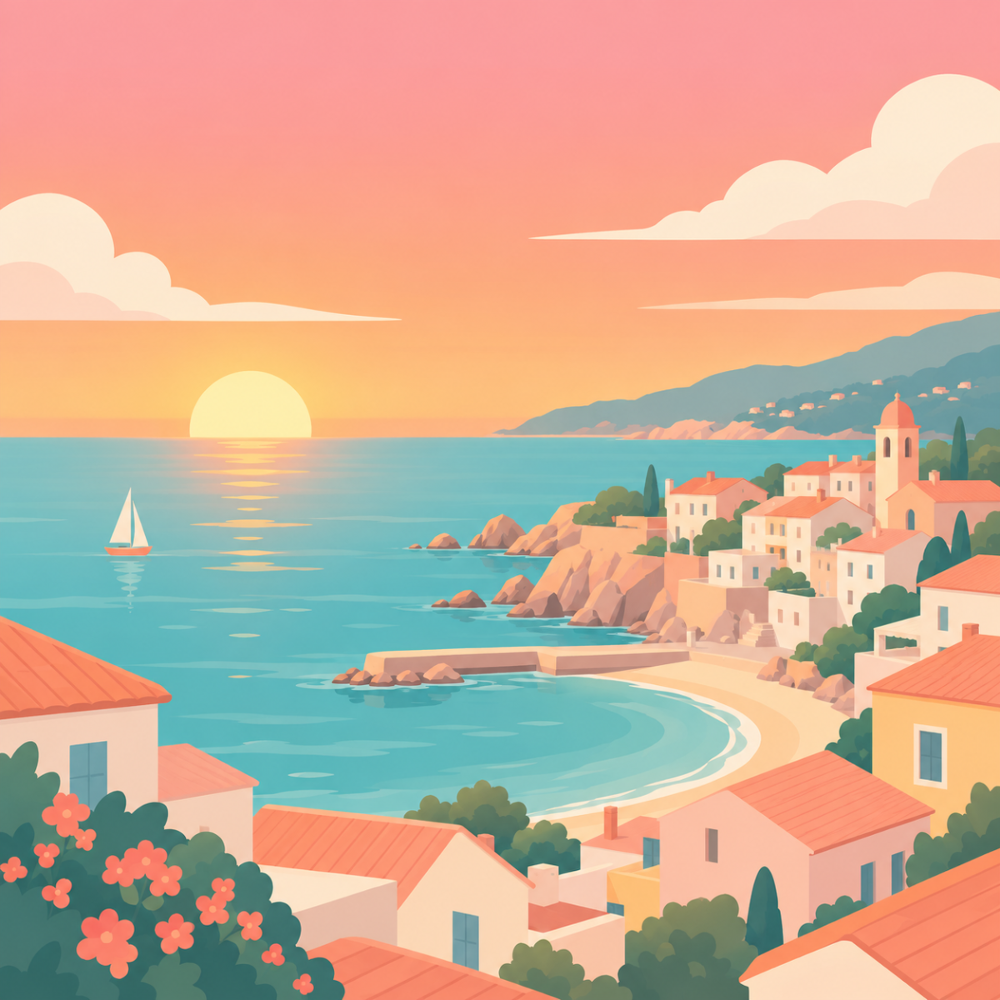
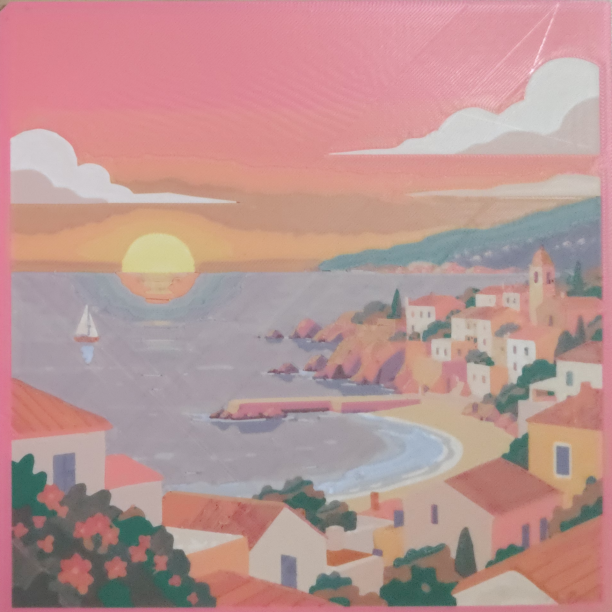
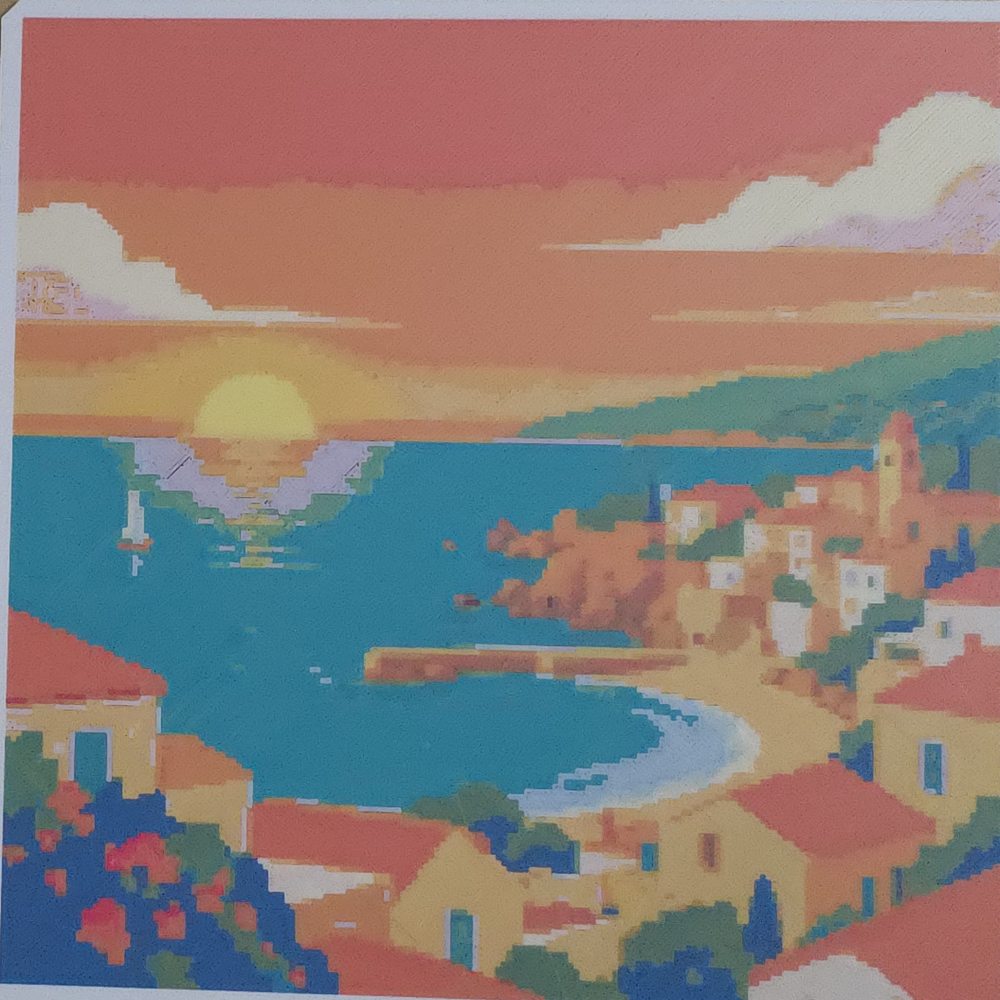
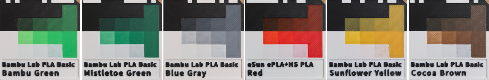
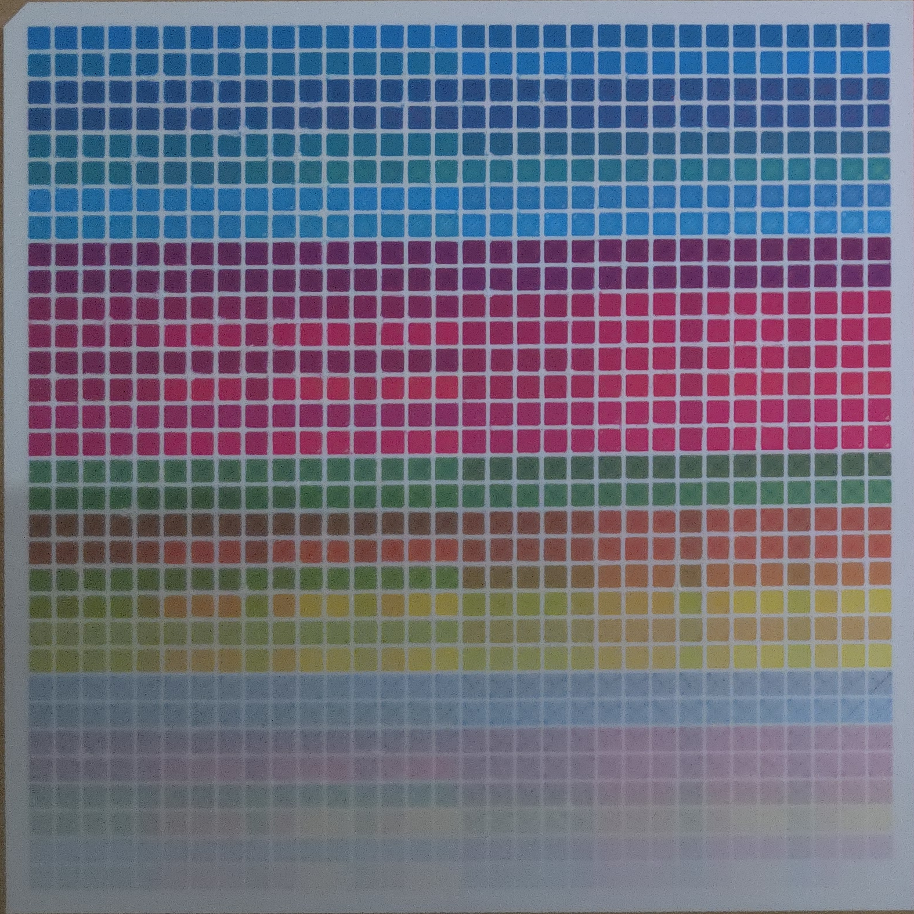
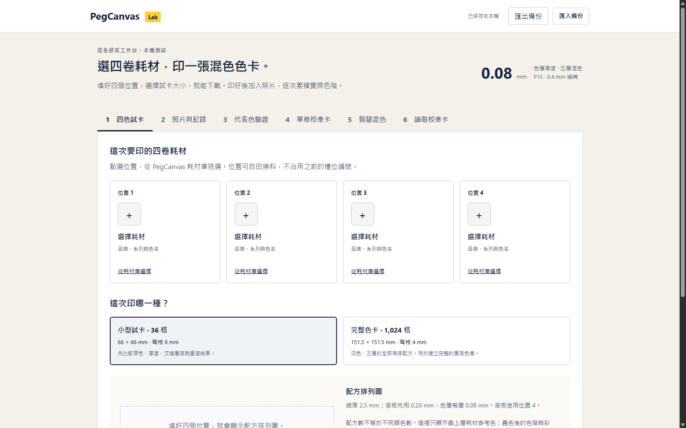

# Color Fusion
### Early Experiments in FDM Color Mixing

I'm experimenting with a way to create colorful FDM prints using ordinary PLA filaments stacked in thin layers.

It's still a work in progress. Some colors look surprisingly good, while others are noticeably off.

I wanted to share a few real prints and show how the project is evolving.

📄 **[View or Download the 3-Page Early Preview PDF](Color_Fusion_Early_Preview.pdf)**

---

## Update — October 24, 2026

A new test print: a 240 × 180 mm anime-style landscape with cherry blossoms, a torii gate and a sunset harbour.

📥 **[Download the 3MF on MakerWorld](https://makerworld.com/en/models/3485087-color-fusion-sunset-shrine-picture)** to print it yourself.

| 1. Original Artwork | 2. Vector Trace (SVG) | 3. Color Fusion Preview | 4. Real Print |
| :---: | :---: | :---: | :---: |
|  |  |  |  |

*How this one was made:* the artwork was first traced into flat vector colour areas in Adobe Illustrator (Image Trace). Color Fusion then took the SVG, picked the filaments, worked out the layer recipes, reduced small islands and produced the 3MF. Color Fusion's own colour separation is still being improved, so for now a vector trace gives the cleanest result.

- **A clear top layer with ironing.** The last 0.08 mm layer is clear PLA, ironed smooth. It gives the surface a soft gloss and makes the colours look deeper. The preview now accounts for it.
- **Clear filament in the mix.** Clear PLA has its own SpoolCard (matte and ironed versions) and can be used as one of the stacked layers to dilute a colour.
- **The preview matched the print.** Comparing a photo of the print with the preview, brightness in most areas differed by only a few points (on a 0–100 scale; the sky came out a little brighter), and the shaded stone steps kept their detail.
- **Printability optimisation, now in use.** On this print it cut the small "islands" from about 20,900 to 14,700 (−30%).

**One thing I learned:** a print can look darker in the hand than on screen. A screen gives off its own light; a print only reflects the light in the room. A photo, or good lighting on the wall, makes it look much closer to the preview.

### Print Details
- **Printer:** Bambu Lab P1S with 2 × AMS (8 filament slots)
- **Size:** 240 mm × 180 mm × 1.08 mm
- **Layers:** 0.6 mm white base, five 0.08 mm colour layers, one 0.08 mm clear top layer (ironed)
- **Filaments (7 colours + clear PLA):**
  1. `Bambu Lab PLA Basic Jade White` (base)
  2. `Bambu Lab PLA Lite Black`
  3. `eSun PLA+ Pink`
  4. `Bambu Lab PLA Basic Orange`
  5. `eSun PLA+ Blue`
  6. `Bambu Lab PLA Basic Blue Gray`
  7. `Polymaker Panchroma Matte Pastel Banana`
  8. `FULABS PLA Transparent` (clear top layer)

**Next:** a simple brightness (EV) control so you can make a print brighter or darker before separating the colours, and packaging the workflow into a simple web tool.

---

## Update — October 22, 2026

Still going! The last two weeks were mostly about one question: **how do we turn a picture into colour areas that print cleanly?**

- **Cleaner prints.** On a detailed anime-style test illustration, switching to cleaner vector colour areas cut the number of tiny "islands" (the little patches a printer has to start and stop on every layer) by **58%**, and the dark ones by **42%**. Streaks and dark specks on light surfaces dropped a lot, and 7 ordinary PLA spools still matched the skin, hair, gold trim and gem colours well.
- **New: printability optimisation (in testing).** Neighbouring areas that look alike now share the same hidden lower layers. In the preview the picture looks the same (average colour change under 1 ΔE), yet islands drop by another **28%** and dark islands by **55%**. It has an adjustable strength, can be switched off, and marks what it changed. A test print is on the bed right now.
- **Colour separation research.** I compared several open-source vectorizers and added a fidelity check that confirms the traced shapes really match the separation. The built-in separator now has smooth curved boundaries and merges fragments while keeping small features such as pupils. It's improving but not yet as polished as dedicated vector tools, so for now vector (SVG) artwork gives the best results.
- **SpoolCard library.** Over 50 spools have been scanned with SpoolCard v3.1 (six cards per plate, one photo each, with a printed filament code on every card).

**Next:** confirm the optimisation on real prints, make the preview show what will actually print (so you can decide whether a hair-thin line is worth keeping), and test a clear top layer with ironing for a smoother finish.

---

## 1. Digital Artwork vs. Latest Real Print

Here is a recent 180 mm × 180 mm test print fresh off the print bed:

| Original Digital Artwork (2D Source) | Actual 3D Print (Bambu P1S + 2 AMS) |
| :---: | :---: |
|  |  |

### Print Details
- **Printer:** Bambu Lab P1S with 2 × AMS (8 filament slots)
- **Print Time:** **4.5 hours**
- **Layer Height:** 0.08 mm (0.4 mm standard nozzle, 100% solid infill)
- **Dimensions:** 180 mm × 180 mm × 2.0 mm
- **Filaments Used (8 Ordinary PLAs):**
  1. `eSun PLA+ Pink` (Base plate & outer frame)
  2. `Jadeway PLA Matte Yellow`
  3. `Bambu PLA Basic Mistletoe Green`
  4. `Bambu PLA Lite Matte Beige`
  5. `eSun ePLA+HS Red`
  6. `Bambu PLA Basic Blue Gray`
  7. `Jadeway PLA Yellow`
  8. `Bambu PLA Basic Jade White`

---

## 2. Evolution: Early Prototype vs. Latest Experiment

Getting plastic layers to blend naturally took a lot of trial, error, and algorithm tuning. It definitely didn't happen overnight!

| Early Prototype (Oct 15) — Stepped & Blocky | Latest Experiment (Oct 20) — Smooth 8-Color |
| :---: | :---: |
|  |  |

- **Oct 15 Prototype:** Noticeable stepped banding across the sky, harsh pixel contours, and oversaturated cyan-green water.
- **Oct 20 Experiment:** Continuous sunset sky gradient, subtle slate-blue aquatic reflections, and crisp architectural rooflines printed in 4.5 hours.

---

## 3. How Does It Work?

You don't need to manually paint pixels or guess layer heights. The workflow is designed to be automated:

1. **Pick Normal PLA:** Grab any regular PLA spools from your shelves (Bambu Lab, eSun, Jadeway, etc.).
2. **Scan a SpoolCard:** Print a small 50×50 mm card to measure how translucent the plastic is at 10 different layer depths.
3. **Auto-Compute Recipes:** Color Fusion searches through layer-stacking combinations to recreate the target image's hues.
4. **Export 3MF & Print:** Load the standard multi-material 3MF file directly into Bambu Studio or OrcaSlicer and print.

---

## 4. SpoolCards & The 1,024-Color Benchmark

To predict how colors will look before melting plastic, Color Fusion uses physical calibration swatches and combinatorial tests:

### Growing Spool Library (SpoolCard v3.1 — 50 × 50 mm)
Each card tests stepped transmission depths from 0.08 mm to 2.0 mm over black and white backings:

*(From left to right: Bambu Green, Mistletoe Green, Blue Gray, eSun Red, Sunflower Yellow, Cocoa Brown)*

### Combinatorial Validation Grid & Studio Prototype
| 1,024 Blended Colors Test Grid (32 × 32) | Color Fusion Studio Workbench Prototype |
| :---: | :---: |
|  |  |

- **1,024 Test Grid:** A physical 32×32 swatch array printed in 4 standard spools to verify how multi-layer blends behave across the full spectrum.
- **Studio Workbench:** A prototype web tool where I assign AMS slots, inspect sub-layer recipes, and export multi-color 3MFs.

---

## 5. Current Challenges & Things Still Being Tuned

This is an active, honest experiment. Here are a few things I'm still figuring out:

- **Shadow Tones:** Very dark pictures are hard: the darkest printable black still reflects a little light, so the deepest shadows can merge together. A brightness control is on the way.
- **Nozzle Purge Volumes:** Extruder flushing is critical. If the nozzle doesn't fully purge rich red or magenta before extruding white, you get an unintended pinkish tint!
- **Filament Brand Variations:** Every brand's "Yellow" or "Cyan" has unique pigment density and opacity, which is why scanning quick SpoolCards is essential.

---

## 6. Community Feedback & Next Steps

I'm actively refining the algorithm and would love to hear from other 3D printing enthusiasts:

- What do you think of this approach to FDM color blending?
- **I'm considering sharing some test 3MF files down the road** if community members with AMS or multi-material setups are interested in test-printing on their own machines!
- What image styles, palettes, or filament brands would you be most excited to see tested next?

Feel free to open an Issue or Discussion on this repository to share your thoughts, ideas, or questions!

---

> **Note**: This repository currently contains project previews and experimental results, not the Color Fusion Engine source code. Source-code and commercial licensing plans have not yet been finalized.
