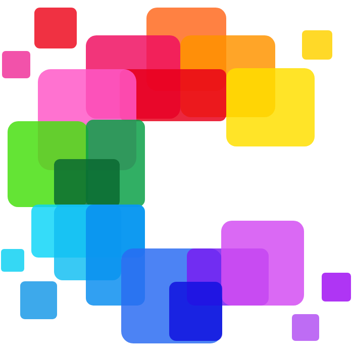
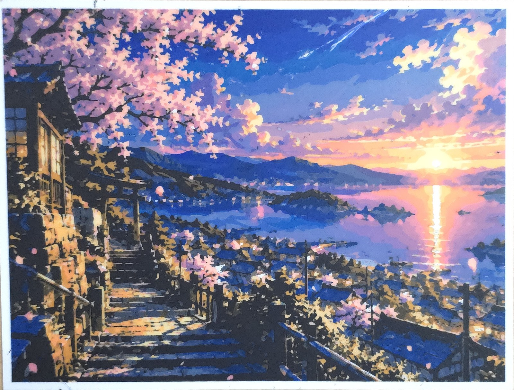
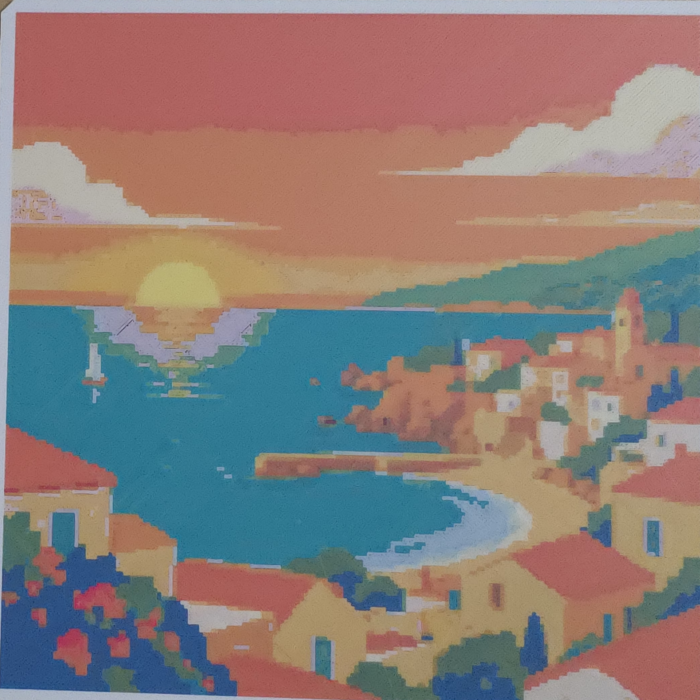
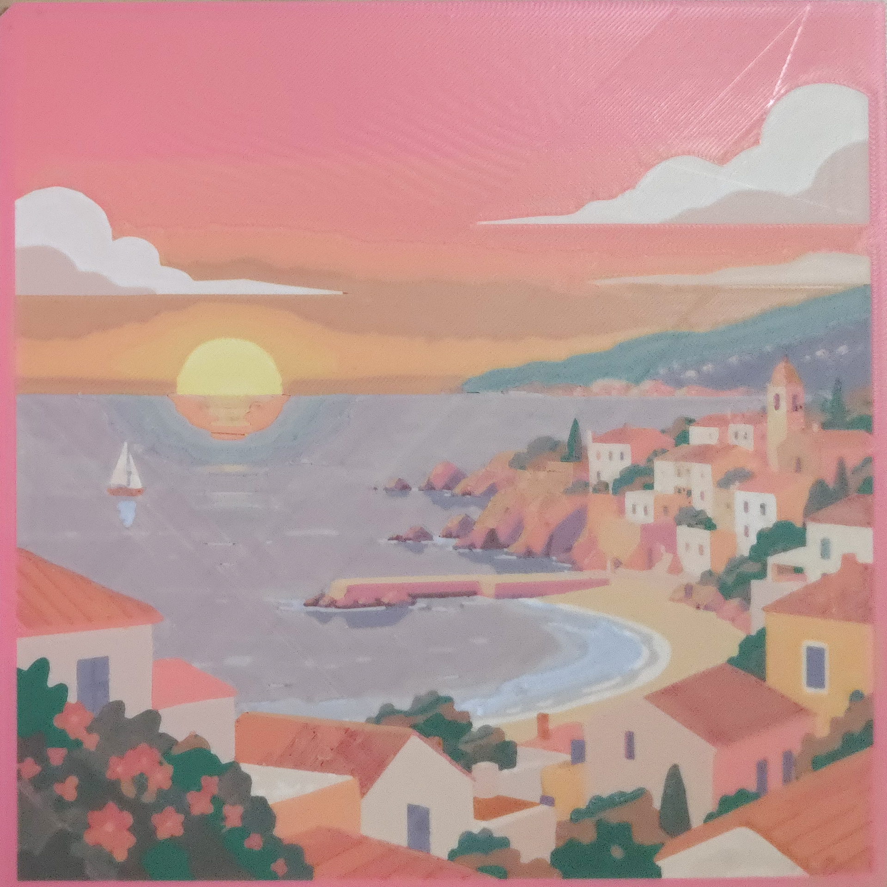
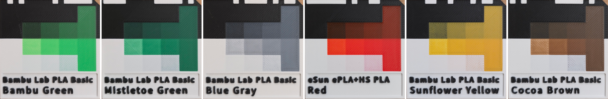
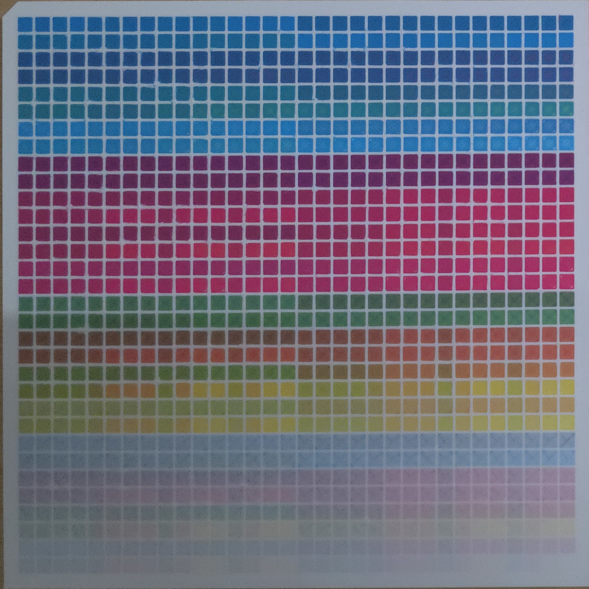

  
  <h1>Color Fusion Studio</h1>
  
<strong>Print full-colour pictures with the ordinary PLA already on your shelf.</strong>

  

    <a href="https://colorfusion.pegcanvas.com"><strong>Open Color Fusion Studio →</strong></a>
  

  
Free · No sign-up · No install · Runs entirely in your browser

## What it does

Color Fusion Studio turns a picture into a multi-colour 3D print. Instead of one flat colour per area, it stacks five thin 0.08 mm layers of different filaments, so the colours mix like glazes. **Use up to 32 filaments: that is over 33 million possible layer stacks.** Even eight spools give 32,768, enough for smooth skies, skin tones and sunsets from plain PLA.

You pick the spools you own, drop in a picture, and download a Bambu Studio project that is ready to slice.

## Get started in three steps

1. **Open [colorfusion.pegcanvas.com](https://colorfusion.pegcanvas.com)**. A short built-in tour shows you around.
2. **Add your picture and set the printed size.** PNG, JPG or SVG.
3. **Choose colours and filaments, check the preview, and download the 3MF.** Open it in Bambu Studio: plates, layer heights and filament slots are already set. Pieces that pause for a filament change come with a print guide picture.

## Features

**Colour**

- **Smart filament picking:** tell Studio how many slots your printer has (2–32) and it chooses the best set from your shelf, then works out a 5-layer recipe for every colour in the picture.
- **Colour separation up to 256 colours,** with a detail level you choose: from clean and simple to keeping single-pixel brushstrokes. Adjust the settings first, then separate when you are ready.
- **Mode A:** a second way of choosing filaments that can bring light colours and skin tones closer to the original on some pictures.
- **Preview before you print:** see the predicted print side by side with your picture, with island count and filament changes.
- **Printability optimisation:** fewer tiny "islands" for the printer to start and stop on, with an adjustable strength you can switch off.
- **Exposure and black-point controls** for dark pictures.

**Shapes and two-sided pieces**

- **Cut along the outline:** turn a picture with a transparent background into a character card or key tag. Pick any border colour and width; the border is mixed from your filaments like the rest of the picture. Small gaps inside the shape are filled automatically.
- **Key holes:** add one or more holes and drag them where you want.
- **Two-sided prints:** a front and a back picture on one canvas, printed as one piece. Use one filament set for both faces, or give the front its own set; Studio plans the pauses and keeps shared spools in the same slots.
- **Print guide:** a picture showing what to load before printing and which slots to change at each pause, with a colour swatch for every spool. It is shown in Studio and included in the download.

**Finish**

- **Clear top coat with ironing:** one transparent layer on top for a smooth, glossy finish.
- **Face-down printing:** print the colour face against the build plate, so the plate gives it its finish with no ironing needed.

**Your spools**

- **Calibrate your own spools:** calibrate up to 62 spools on one SpoolCard plate set, photograph them, and Studio measures how each filament really mixes. Calibrated spools give the most faithful preview.
- **Import and export colour profiles** to back them up or move them to another computer.

**Everything else**

- **Private by design:** all the maths runs on your computer. Your pictures are never uploaded.
- **English, 繁體中文 and 简体中文.**

## Gallery

A 240 × 180 mm test print, from artwork to print:

| Artwork | Colour areas | Preview | Print |
| :---: | :---: | :---: | :---: |
|  |  |  |  |

📥 [Download this model on MakerWorld](https://makerworld.com/en/models/3485087-color-fusion-sunset-shrine-picture) and print it yourself.

Print details

- **Printer:** Bambu Lab P1S with 2 × AMS (8 slots)
- **Size:** 240 × 180 × 1.08 mm
- **Layers:** 0.6 mm white base, five 0.08 mm colour layers, one 0.08 mm clear top layer (ironed)
- **Filaments:** Bambu Lab PLA Basic Jade White (base), Bambu Lab PLA Lite Black, eSun PLA+ Pink, Bambu Lab PLA Basic Orange, eSun PLA+ Blue, Bambu Lab PLA Basic Blue Gray, Polymaker Panchroma Matte Pastel Banana, FULABS PLA Transparent (clear top)

| Early prototype (Oct 15) | Smooth 8-colour print (Oct 20) |
| :---: | :---: |
|  |  |

The SpoolCard library and a 1,024-colour test grid used to tune the colour model:

| SpoolCards | 1,024-colour test grid |
| :---: | :---: |
|  |  |

## Print them yourself on MakerWorld

Free models made with Color Fusion, ready to print:

- 🌅 [Color Fusion: Sunset Shrine Picture](https://makerworld.com/en/models/3485087-color-fusion-sunset-shrine-picture), the 240 × 180 mm print in the gallery above.
- 🧝 [PegCanvas: Frieren Color Fusion Picture](https://makerworld.com/en/models/3501512-pegcanvas-frieren-color-fusion-picture)

More models on [my MakerWorld page](https://makerworld.com/en/@user_3932360276/upload).

## What you need

- A multi-colour FDM printer, such as a Bambu Lab printer with AMS.
- PLA filaments. The colour model is verified for PLA.
- A computer with a modern browser.

**Tested on:** Bambu Lab P1S + AMS. Other printers have not been tested; open the 3MF in Bambu Studio and switch the printer there.

## Good to know

- **Uncalibrated spools are estimated** from their catalogue colour, so the print can differ from the preview. Print a SpoolCard for an accurate result.
- **Prints look darker in the hand than on screen.** A screen gives off light; a print only reflects the light in the room. Good lighting brings it close to the preview.
- **Very busy pictures make big files.** Fewer colours or a lower detail level keep files light.

## Free, and yours

- **Color Fusion Studio is free.** No sign-up, no install.
- **What you make is yours.** Recipes, 3MF files and prints belong to you. Share them, publish them, or sell them on Etsy, MakerWorld, Printables or at a craft fair. No royalties.
- **Your pictures are your responsibility.** Make sure you have the right to print the images you use.
- The web app itself is closed-source. Please don't mirror it or reverse-engineer it. The full terms are on the website.

## Feedback

Questions, ideas and print photos are very welcome. Open an [Issue or Discussion](https://github.com/webber0612/color-fusion/issues) on this repository.

Development notes

### November 13, 2026: Redesigned FOCUS (V1.4.0)
FOCUS now opens a dialog above the page with the original and the predicted print side by side, front above back on double-sided pieces. Areas are marked by clicking points around them; the wheel zooms at the cursor, the middle button pans and Fit to window resets the view. Each face keeps its own areas: with a separate set per face they weigh only that face's recipe search, and with one shared set they map onto the right face.

### November 13, 2026: Border colour by recipe (V1.3.8)
With the outline cut on, the border is now a colour instead of a filament. The colour joins the picture's palette, the recipe search mixes it from layered filaments, and the outline is filled with that recipe layer by layer, including where it reaches past the canvas. Its sides show the base colour. The separation step no longer starts on entry; it runs when the user presses Separate colours.

### November 12, 2026: Border filament (V1.3.7)
With the outline cut on, the border width and its filament are one setting. The border is printed in the base spool, so choosing its filament locks the base; on double-sided pieces both faces' bases use it and the border matches. Automatic leaves the choice to the recipe search. The print guide picture carries the Color Fusion logo, and an empty face no longer clips its upload area.

### November 12, 2026: Print guide picture (V1.3.6)
After the recipe search, Studio draws a print guide: every slot to load before printing with a colour swatch, then only the slots that change at each pause, plus how many times the piece pauses. It is shown in step 3, downloadable as PNG and included in the ZIP. On double-sided cards with a separate front set, filament used on both faces keeps its slot at the switch, so no spool moves between slots; only the slot numbering changes.

### November 12, 2026: Outline-card export fix (V1.3.5)
Some outline-cut cards with a small sealed gap (for example between a character's legs) failed to produce a 3MF: when a pinched contour was split, the artwork hole could be attached to the small gap piece inside it. A hole now only belongs to an outer larger than itself. Also: an empty back face keeps its upload area, the clear-coat setting asks whether the clear filament takes its own slot, and the STEP 3 tip floats over the canvas.

### November 12, 2026: Cleaner outlines (V1.3.4)
The outline border now extends past the canvas instead of being clipped, and its inner corners are rounded. Step 1 draws the same outline the model uses and shows the finished size. Edge pixels no longer blend into the white background, which removes the light ring around characters. Enclosed holes below the fill limit (100 mm² by default) are sealed in the outline colour; larger ones stay open with a thin lining.

### November 12, 2026: Both faces on one canvas (V1.3.3)
A double-sided card now shows its front and back rows, across every step, on one canvas. Zooming and panning move the whole layout together, and the card's size and shape can be changed while the back face is selected.

### November 12, 2026: One-click outline cards (V1.3.2)
Importing a picture with a transparent background now offers to cut the card along its outline, and the outline is its own switch under appearance settings. On two-sided pieces, the back view shows the outline mirrored, as the card looks when turned over, so back artwork lines up.

### November 12, 2026: Several holes per card (V1.3.1)
A card can now have up to eight holes, for example one at the top and one at the bottom to link cards into a chain. All holes share one diameter and edge width, and each hole is placed on its own: inside the card it is a plain opening, and outside the shape it grows its own ear.

### November 12, 2026: Front and back on one canvas, key holes (V1.3.0)
Two-sided projects now show the front and back side by side on one canvas, and pictures can be dragged between the faces. Cards can have a key hole from 2 to 8 mm that you drag into place: inside the card it is a plain hole, and past the edge a rounded tab grows out to hold it. Two-sided exports now work with the prime tower turned on, keep the back filament set within the AMS slots, and list the slot shared with the clear layer in the clear colour, so the filament mapping at print start picks the loaded spool.

### November 9, 2026: Two-sided prints, face-down printing & silhouette cards (V1.1.0)
Color Fusion Studio 1.1 adds two-sided projects, where the back face can use its own filament set, swapped at a pause. It also adds face-down printing, which picks up the texture of your build plate, and silhouette-shaped cards with an adjustable smooth border for images with a transparent background. A shared clear slot lets a full 8-colour project keep its clear top coat. This release also fixes colour areas that overlapped where pixels touch only at a corner, which could make the clear top layer print as rough bridging patches.

### November 3, 2026: Import & export your colour profiles, cleaner crop edges (V1.0.3)
My Filaments now has import and export buttons for your colour profile files (.json), so you can back up your calibrations or move them to another computer. Cropping an image to the board size no longer leaves a thin white line along the edge of the print.

### November 2, 2026: Mode A, printed colours & RGB filament list (V1.0.2)
Exported 3MF files now use each spool's measured printed colour. The filament list gives RGB values you can type straight into Bambu Studio. Adds optional Mode A colour selection, a crop-and-resize-canvas button, a finer detail control and a fix for the base spool being swapped.

### October 29, 2026: 3MF slicing precision & Studio polish (V1.0.1)
Fixed a critical variable layer-height transition in exported Bambu Studio 3MF files, ensuring 0.2 mm base + 0.08 mm color layers slice cleanly and print reliably. Enhanced regional FOCUS color weighting and updated UI layout.

### October 28, 2026: V1.0 released
Color Fusion Studio V1.0 is live at [colorfusion.pegcanvas.com](https://colorfusion.pegcanvas.com), in English and 繁體中文, with canvas editing, printability optimisation and one-click Bambu Studio export.

### October 24, 2026: the sunset shrine print
The gallery print above. The artwork was traced into flat colour areas with a vector app's image-trace feature; Color Fusion picked the filaments, worked out the recipes, reduced small islands and produced the 3MF. A clear PLA top layer, ironed smooth, gives a soft gloss and deeper colours. Comparing a photo of the print with the preview, most areas differed by only a few points of brightness. Printability optimisation cut islands from about 20,900 to 14,700 (−30%).

### October 22, 2026: cleaner colour areas
On a detailed anime-style test illustration, cleaner vector colour areas cut tiny islands by 58% (dark ones by 42%). Printability optimisation took islands down another 28% with an average colour change under 1 ΔE. Over 50 spools were scanned with SpoolCards.

### October 20, 2026: first smooth 8-colour print
A 180 × 180 mm test print on a Bambu Lab P1S with 2 × AMS, eight ordinary PLAs, 4.5 hours.

📄 [Early preview PDF](Color_Fusion_Early_Preview.pdf)
