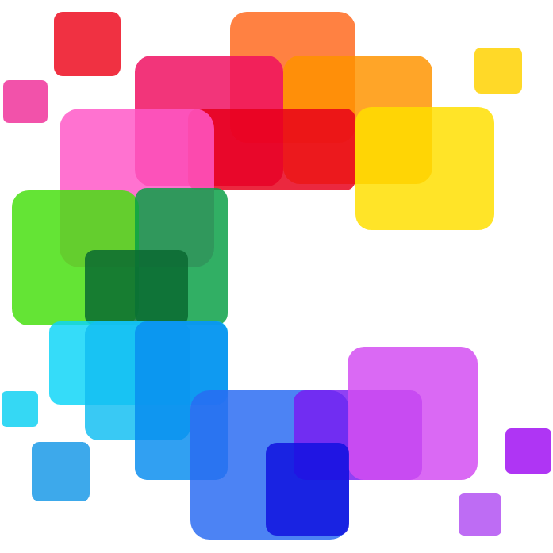

  
  <h1>Color Fusion Studio</h1>
  
<strong>Print full-colour pictures with the ordinary PLA already on your shelf.</strong>

  

    <a href="https://colorfusion.pegcanvas.com"><strong>Open Color Fusion Studio →</strong></a>
  

  
Free · No sign-up · No install · Runs entirely in your browser

## What it does

Color Fusion Studio turns a picture into a multi-colour 3D print. Instead of one flat colour per area, it stacks five thin 0.08 mm layers of different filaments, so the colours mix like glazes. **Use up to 32 filaments: that is over 33 million possible layer stacks.** Even eight spools give 32,768, enough for smooth skies, skin tones and sunsets from plain PLA.

You pick the spools you own, drop in a picture, and download a Bambu Studio project that is ready to slice.

## Get started in three steps

1. **Open [colorfusion.pegcanvas.com](https://colorfusion.pegcanvas.com)**. A short built-in tour shows you around.
2. **Add your picture and set the printed size.** PNG, JPG, WebP or SVG.
3. **Choose colours and filaments, check the preview, and download the 3MF.** Open it in Bambu Studio: plates, layer heights and filament slots are already set.

## Features

- **Smart filament picking:** tell Studio how many slots your printer has (2–32) and it chooses the best set from your shelf, then works out a 5-layer recipe for every colour in the picture.
- **Colour separation up to 256 colours,** with a detail level you choose: from clean and simple to keeping single-pixel brushstrokes.
- **Preview before you print:** see the predicted print side by side with your picture, with island count and filament changes.
- **Printability optimisation:** fewer tiny "islands" for the printer to start and stop on, with an adjustable strength you can switch off.
- **Exposure and black-point controls** for dark pictures.
- **Clear top coat with ironing:** one transparent layer on top for a smooth, glossy finish.
- **Calibrate your own spools:** calibrate up to 62 spools on one SpoolCard plate set, photograph them, and Studio measures how each filament really mixes. Calibrated spools give the most faithful preview.
- **Private by design:** all the maths runs on your computer. Your pictures are never uploaded.
- **English and 繁體中文.**

## Gallery

A 240 × 180 mm test print, from artwork to print:

| Artwork | Colour areas | Preview | Print |
| :---: | :---: | :---: | :---: |
|  |  |  |  |

📥 [Download this model on MakerWorld](https://makerworld.com/en/models/3485087-color-fusion-sunset-shrine-picture) and print it yourself.

Print details

- **Printer:** Bambu Lab P1S with 2 × AMS (8 slots)
- **Size:** 240 × 180 × 1.08 mm
- **Layers:** 0.6 mm white base, five 0.08 mm colour layers, one 0.08 mm clear top layer (ironed)
- **Filaments:** Bambu Lab PLA Basic Jade White (base), Bambu Lab PLA Lite Black, eSun PLA+ Pink, Bambu Lab PLA Basic Orange, eSun PLA+ Blue, Bambu Lab PLA Basic Blue Gray, Polymaker Panchroma Matte Pastel Banana, FULABS PLA Transparent (clear top)

| Early prototype (Oct 15) | Smooth 8-colour print (Oct 20) |
| :---: | :---: |
|  |  |

The SpoolCard library and a 1,024-colour test grid used to tune the colour model:

| SpoolCards | 1,024-colour test grid |
| :---: | :---: |
|  |  |

## Print them yourself on MakerWorld

Free models made with Color Fusion, ready to print:

- 🌅 [Color Fusion: Sunset Shrine Picture](https://makerworld.com/en/models/3485087-color-fusion-sunset-shrine-picture), the 240 × 180 mm print in the gallery above.
- 🧝 [PegCanvas: Frieren Color Fusion Picture](https://makerworld.com/en/models/3501512-pegcanvas-frieren-color-fusion-picture)

More models on [my MakerWorld page](https://makerworld.com/en/@user_3932360276/upload).

## What you need

- A multi-colour FDM printer, such as a Bambu Lab printer with AMS.
- PLA filaments. The colour model is verified for PLA.
- A computer with a modern browser.

**Tested on:** Bambu Lab P1S + AMS. Other printers have not been tested; open the 3MF in Bambu Studio and switch the printer there.

## Good to know

- **Uncalibrated spools are estimated** from their catalogue colour, so the print can differ from the preview. Print a SpoolCard for an accurate result.
- **Prints look darker in the hand than on screen.** A screen gives off light; a print only reflects the light in the room. Good lighting brings it close to the preview.
- **Very busy pictures make big files.** Fewer colours or a lower detail level keep files light.

## Free, and yours

- **Color Fusion Studio 1.0 is free.** No sign-up, no install.
- **What you make is yours.** Recipes, 3MF files and prints belong to you. Share them, publish them, or sell them on Etsy, MakerWorld, Printables or at a craft fair. No royalties.
- **Your pictures are your responsibility.** Make sure you have the right to print the images you use.
- The web app itself is closed-source. Please don't mirror it or reverse-engineer it. The full terms are on the website.

## Feedback

Questions, ideas and print photos are very welcome. Open an [Issue or Discussion](https://github.com/webber0612/color-fusion/issues) on this repository.

Development notes

### October 28, 2026: V1.0 released
Color Fusion Studio V1.0 is live at [colorfusion.pegcanvas.com](https://colorfusion.pegcanvas.com), in English and 繁體中文, with canvas editing, printability optimisation and one-click Bambu Studio export.

### October 24, 2026: the sunset shrine print
The gallery print above. The artwork was traced into flat colour areas with a vector app's image-trace feature; Color Fusion picked the filaments, worked out the recipes, reduced small islands and produced the 3MF. A clear PLA top layer, ironed smooth, gives a soft gloss and deeper colours. Comparing a photo of the print with the preview, most areas differed by only a few points of brightness. Printability optimisation cut islands from about 20,900 to 14,700 (−30%).

### October 22, 2026: cleaner colour areas
On a detailed anime-style test illustration, cleaner vector colour areas cut tiny islands by 58% (dark ones by 42%). Printability optimisation took islands down another 28% with an average colour change under 1 ΔE. Over 50 spools were scanned with SpoolCards.

### October 20, 2026: first smooth 8-colour print
A 180 × 180 mm test print on a Bambu Lab P1S with 2 × AMS, eight ordinary PLAs, 4.5 hours.

📄 [Early preview PDF](Color_Fusion_Early_Preview.pdf)
